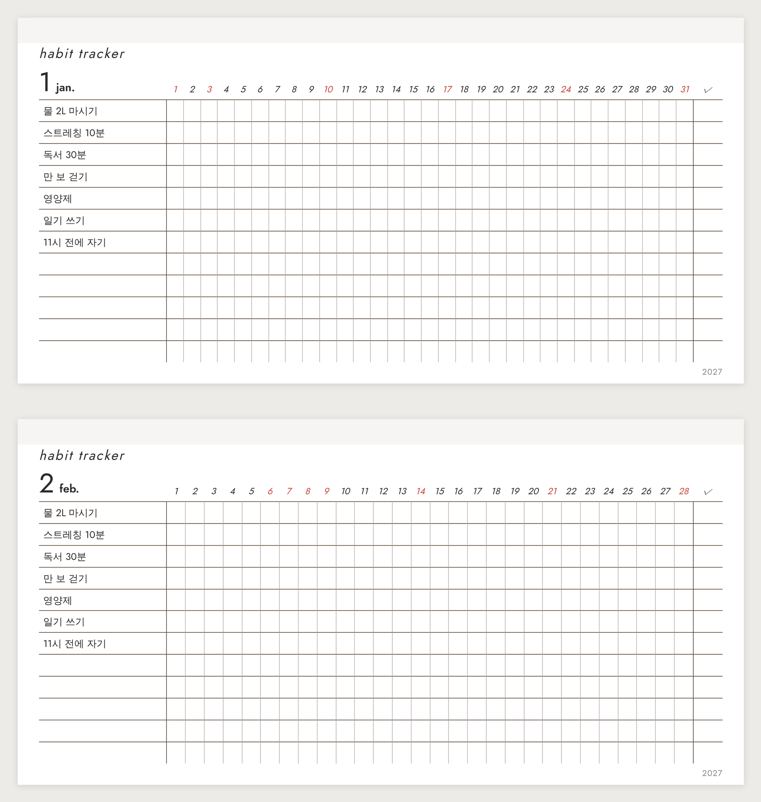

# Habit Tracker Generator

**한국어** | [English](README.en.md)

시스템 다이어리용 해빗트래커 속지를 만들어 PDF로 저장하는 편집 도구예요. 설치 없이 브라우저에서 바로 써요.

**바로 쓰기:** https://mov-ie.github.io/habit-tracker-generator/

## 어떤 속지인가요

속지를 **옆으로 눕혀서** 쓰는 해빗트래커예요. 날짜 1~31이 속지의 긴 쪽(171mm)을 따라 가로로 흐르고, 습관은 세로로 한 줄씩 들어가요. 한 달에 한 쪽이에요.

## 할 수 있는 것

- **날짜형 / 만년형:** 연도와 날짜가 찍힌 버전, 또는 1~31만 있고 월을 직접 적는 빈 버전.
- **빨간날:** 일요일과 한국 공휴일(대체공휴일 포함)을 빨간색으로 표시해요. 공휴일은 매달 자동으로 새 자료를 받아 와요(아래 참고). 원하는 날짜를 직접 추가할 수도 있어요.
- **트래커 모양:** 습관 줄 수, 습관 이름 칸 폭, 합계 칸, 요일 표시(기본은 없음, s m t / su mo로 켤 수 있어요), 날짜 세로선(없음·연하게·진하게), 일요일 앞 주 구분선, 주말 음영.
- **습관 이름 미리 넣기:** 한 줄에 하나씩 적으면 매달 같은 습관이 인쇄돼요. 비워 두면 빈칸으로 나와요.
- **글꼴:** 전체 폰트(기본 Futura)와 **습관 이름 폰트를 따로** 고를 수 있어요. 글자 크기와 기울임도 바꿔요.
- **색과 선:** 선 색(기본 다크 브라운 #5B4636), 선 굵기, 글자 색, 빨간날 색, 토요일 색, 음영 색.
- **링 방향:** 다이어리를 시계 방향으로 돌려 링이 위로 오게 쓸지, 아래로 오게 쓸지 고르세요. 뒷면 쪽은 링 쪽 여백이 자동으로 반대편으로 가요.
- **출력 배치:** 속지 크기 그대로 저장하거나, A4·A3 한 장에 여러 쪽을 재단선과 함께 배치해요. 단면과 양면을 고를 수 있어요.

## 사용법

1. 페이지를 열어요.
2. 왼쪽 패널에서 **연도, 시작 월, 끝 월**을 정해요.
3. **트래커** 칸에서 습관 줄 수와 모양을 고르고, 필요하면 습관 이름을 적어요.
4. 폰트, 색, 여백을 원하는 대로 바꾸세요. 오른쪽 미리보기가 바로 바뀌어요.
5. **출력 용지**를 고르세요.
   - **속지 크기:** 86×171mm 실제 크기로 한 쪽씩 저장해요.
   - **A4 / A3:** 한 장에 여러 쪽을 배치해요. 86×171mm는 A4 가로에 3쪽이 들어가요.
6. 맨 아래 **PDF로 저장 / 인쇄**를 누르고, 인쇄 창에서 **PDF로 저장**을 고르세요.

설정은 브라우저에 저장돼서 다음에 열어도 그대로예요. 처음 상태로 돌리려면 **처음 설정으로 되돌리기**를 누르세요.

### 폰트 안내

기본 폰트는 Futura예요. PC에 Futura가 있으면(맥에는 기본으로 있어요) Futura로 나오고, 없으면 비슷한 무료 폰트 Jost로 나와요. **제목 폰트**와 **습관 이름 폰트**는 따로 고를 수 있어요. 습관 이름은 한글이 많으니 산돌고딕, 맑은 고딕, 명조, 나눔 계열 같은 한글 폰트가 좋아요. 목록에 없는 폰트도 PC(맥, 윈도우 모두)에 설치돼 있으면 **직접 입력**에 이름을 적어 쓸 수 있어요.

## 공휴일 자동 업데이트

공휴일은 `holidays.json` 파일에 들어 있고, 페이지가 열릴 때 이 파일을 읽어요.

- **GitHub Actions**가 매달 1일에 공공데이터포털의 *한국천문연구원 특일 정보* API에서 공휴일을 받아 `holidays.json`을 갱신해요. 대체공휴일과 임시공휴일도 발표되면 반영돼요.
- 빨간날 자료는 이렇게 나뉘어요.
  - **발표된 해:** API로 받은 공식 공휴일이에요.
  - **2029~2030년:** 미리 계산해 둔 추정 공휴일이에요(설날·추석·부처님오신날·대체공휴일 포함, 선거일이나 임시공휴일은 빠져 있어요). API에 공식 자료가 나오면 자동으로 바뀌어요.
  - **그 뒤의 해:** 발표되기 전까지는 일요일만 빨간색이에요. 연도는 제한 없이 고를 수 있어요.
- 매달 작년부터 5년 뒤까지 확인해서, 새로 발표된 해는 다음 실행 때 자동으로 채워져요.
- 공개 저장소에서는 GitHub Actions가 무료예요.
- 저장소에 활동이 60일 넘게 없어도 예약 실행이 멈추지 않도록, 실행할 때마다 스스로 다시 켜 둬요.

### 처음 한 번만 설정하기

1. [공공데이터포털](https://www.data.go.kr)에서 **한국천문연구원_특일 정보**를 검색해 활용 신청을 해요. 승인되면 마이페이지에서 인증키를 볼 수 있어요(인코딩·디코딩 키 아무거나 괜찮아요).
2. 이 저장소의 **Settings → Secrets and variables → Actions → New repository secret**에서 이름은 `HOLIDAY_API_KEY`, 값은 인증키로 저장해요.
3. **Actions** 탭 → **Update holidays** → **Run workflow**를 눌러 한 번 바로 실행해 보세요. 성공하면 `holidays.json`이 갱신된 커밋이 생겨요.

키가 없으면 업데이트만 건너뛰고, 페이지는 들어 있는 자료로 그대로 동작해요. 페이지 파일을 내려받아 PC에서 바로 열 때도 내장된 자료를 써요.

## 프린트 팁

**인쇄 창 설정**
- 배율은 **100% (실제 크기)**로 두세요. "용지에 맞추기"가 켜져 있으면 속지가 줄어들어요.
- 여백은 **없음**으로 하세요.
- **머리글과 바닥글**을 끄세요.
- **배경 그래픽**을 켜세요. 빨간날 색과 주말 음영이 유지돼요.
- 용지 크기가 자동으로 잡히지 않으면 **Chrome**으로 열어 보세요.

**양면 인쇄**
- 출력 배치를 **양면**으로 하면 낱장 앞면에 1월, 뒷면에 2월처럼 두 달씩 앞뒤로 맞춰 줘요.
- 세로 배치는 **긴 쪽 넘기기**, 가로 배치는 **짧은 쪽 넘기기**로 출력하세요. 패널에도 안내가 나와요.

**재단과 용지**
- 한 장만 먼저 뽑아서 자로 크기를 재 보세요.
- 재단선을 켜면 각 쪽 모서리 바깥에 자를 위치가 표시돼요.
- 프린터는 보통 가장자리 3~5mm를 못 찍어요. **프린터 안전 여백**에 그 값을 넣어 두면 잘리지 않게 배치해요.

## 같이 쓰면 좋은 도구

- [Monthly Generator](https://mov-ie.github.io/monthly-generator/): 같은 스타일의 먼슬리 속지와 A4 큰 달력.
